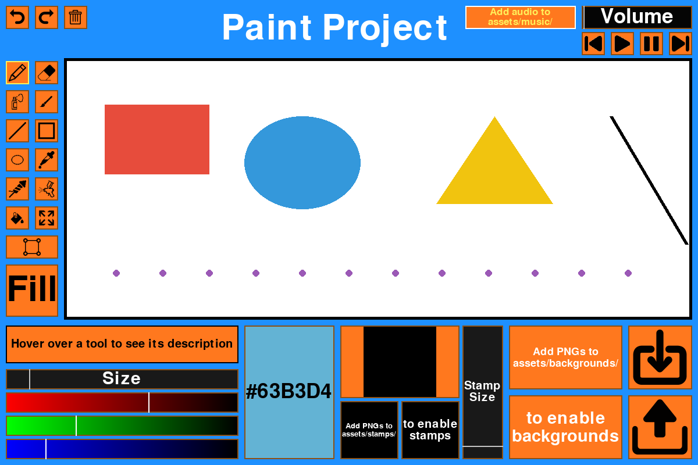

# Paint Project

A desktop paint application built with Python and pygame. It packs a full set of
drawing tools, undo/redo, a select-and-move tool with resize handles, stamps,
custom backgrounds, and a built-in music player into a single window.



## Features

- **Drawing tools**: pencil, eraser, spray, paint brush, line, rectangle,
  ellipse, eye dropper, fireworks, airbrush, paint bucket, fill screen.
- **Shape modifiers**: hold `Shift` to snap lines to 90 degrees, draw squares
  instead of rectangles, and circles instead of ellipses. The fill button
  toggles between outline and filled shapes.
- **Stamp tool**: drop an image onto the canvas and resize it with the stamp
  size slider.
- **Select tool**: select a region of the canvas, move it around, and grab the
  corner handles to resize it.
- **Undo/redo**: `Ctrl+Z` to undo, `Ctrl+Y` (or `Ctrl+Shift+Z`) to redo, or use
  the on-screen buttons.
- **Save / Load**: export the canvas to a PNG, or load a PNG/JPG back onto the
  canvas.
- **Clear canvas**: the trash button or the `X` key.
- **Colour picker**: RGB sliders with a live hex code preview.
- **Tool size slider**: change the brush / radius size.
- **Backgrounds**: cycle through background images with the forward/back
  previews.
- **Music player**: play, pause, next, previous, and a volume slider, with the
  current track name on screen.

## Tech stack

- [Python 3](https://www.python.org/)
- [pygame](https://www.pygame.org/)
- [NumPy](https://numpy.org/)

## Install

```bash
pip install -r requirements.txt
```

## Run

```bash
python main.py
```

## Adding your own assets

The UI images for the tools, buttons, and music controls ship with the repo,
but the canvas content (backgrounds, stamps, music) is yours to drop in. The app
reads these folders at startup and stays usable even when they are empty:

- `assets/backgrounds/` - full-screen background images (PNG/JPG). Cycle them
  with the forward/back preview buttons.
- `assets/stamps/` - images you can stamp onto the canvas (PNG/JPG with
  transparency works best).
- `assets/music/` - audio tracks (MP3/OGG/WAV). The music player auto-advances
  when a track ends.
- `assets/title.png` - optional image shown in the header. If absent, a text
  title is drawn instead.

Only ship media you have the rights to distribute. If you fork this repo, do
not commit copyrighted music, characters, or artwork.

## License

[MIT](LICENSE) - the code in this repository is free to use, modify, and
distribute under the terms of the MIT License. The default UI icons in
`assets/buttons/`, `assets/tools/`, and `assets/music_buttons/` are part of this
project and covered by the same license. Any backgrounds, stamps, music, or
title art you add are your own responsibility to license.
